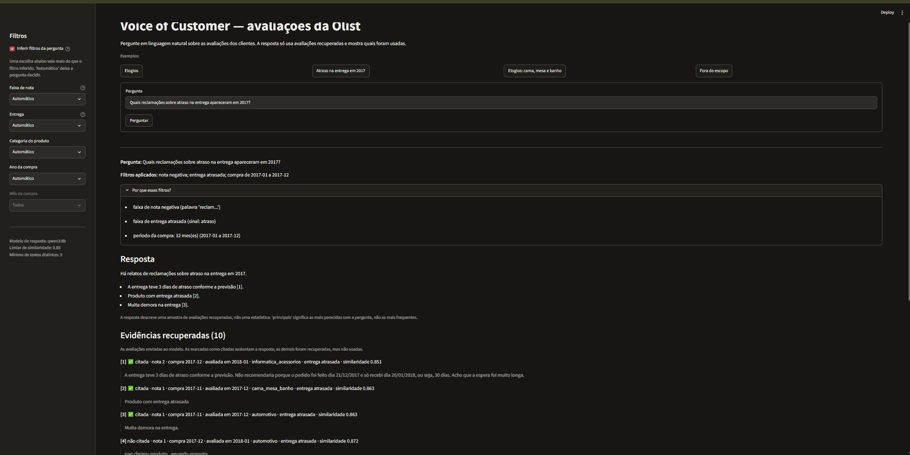
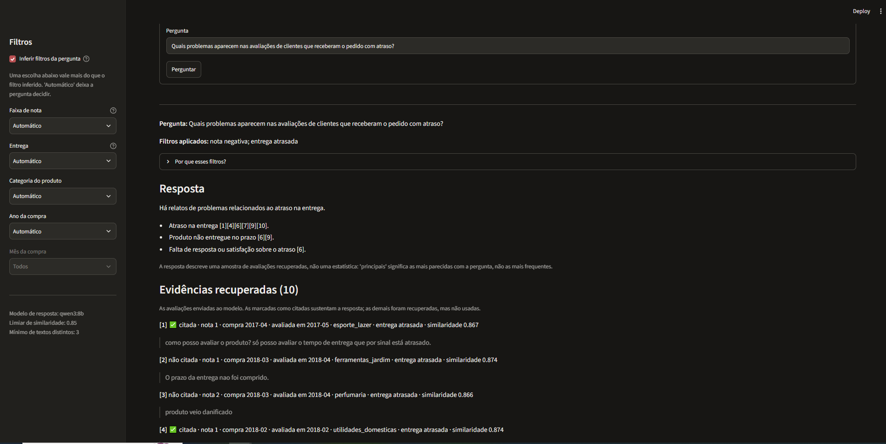
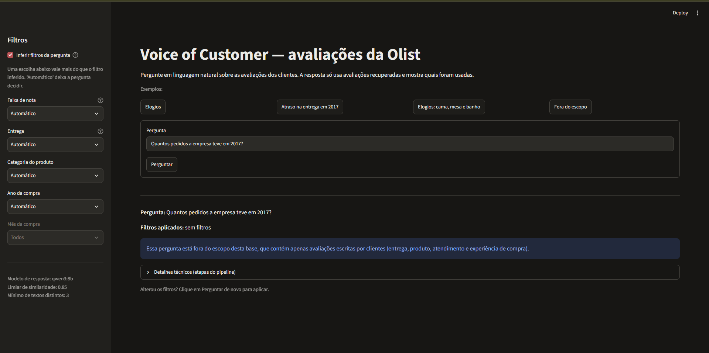
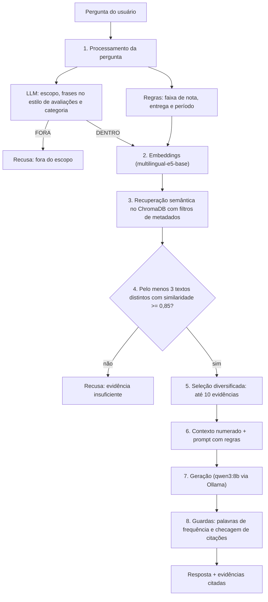

# Voice of Customer Intelligence com RAG — avaliações da Olist

Projeto do **Tech Challenge – Fase 4 (POSTECH)**. Um sistema de *Retrieval-Augmented Generation* que permite a gestores e analistas fazerem perguntas em linguagem natural sobre as avaliações escritas por clientes da base [Brazilian E-Commerce Public Dataset by Olist](https://www.kaggle.com/datasets/olistbr/brazilian-ecommerce) e receberem respostas **fundamentadas em evidências**: cada afirmação cita as avaliações que a sustentam, e o sistema **recusa** perguntas fora do escopo ou sem evidência suficiente, em vez de inventar.

Tudo roda **localmente e sem custo**: modelo de linguagem via Ollama, embeddings e banco vetorial na própria máquina.

> **Resumo dos resultados** (detalhes na seção [Avaliação](#avaliação)): na terceira rodada de avaliação, as 25 perguntas válidas foram respondidas e as 11 perguntas fora do escopo foram recusadas nas 3 execuções de cada uma (33 de 33); mediana de 8,1 s por resposta. O classificador de escopo errou duas vezes ao longo do projeto e foi corrigido duas vezes; as duas falhas estão documentadas. O ponto mais fraco medido é a **precisão das citações**: em 60 pares afirmação–citação avaliados manualmente, 45% sustentam diretamente a afirmação, 48% sustentam em parte e 7% não sustentam.

## Sumário

1. [Problema de negócio](#problema-de-negócio)
2. [Demonstração](#demonstração)
3. [Arquitetura](#arquitetura)
4. [Tecnologias](#tecnologias)
5. [Preparação da base de conhecimento](#preparação-da-base-de-conhecimento)
6. [Pipeline RAG](#pipeline-rag)
7. [Metadados e filtros](#metadados-e-filtros)
8. [Decisões técnicas](#decisões-técnicas)
9. [Avaliação](#avaliação)
10. [Exemplos de perguntas e respostas](#exemplos-de-perguntas-e-respostas)
11. [Problemas encontrados e como foram resolvidos](#problemas-encontrados-e-como-foram-resolvidos)
12. [Limitações](#limitações)
13. [Como reproduzir](#como-reproduzir)
14. [Estrutura do repositório](#estrutura-do-repositório)

## Problema de negócio

Empresas de e-commerce recebem milhares de avaliações. As notas mostram o nível de satisfação, mas os motivos estão nos comentários, difíceis de ler em escala. Este sistema responde perguntas como:

- Quais são os principais motivos de insatisfação dos clientes?
- O que os clientes relatam sobre problemas de entrega?
- O que os clientes elogiam em determinada categoria de produto?
- Quais avaliações sustentam a conclusão de que há problemas recorrentes com o prazo de entrega?

A resposta sempre vem acompanhada das avaliações usadas, para que o gestor possa verificar cada afirmação.

## Demonstração

Interface Streamlit: filtros editáveis na barra lateral, resposta com citações e a lista de evidências, com a marca das que foram citadas.







## Arquitetura



**Defesas em camadas contra alucinação:** classificador de escopo (LLM) → limiar de similaridade e mínimo de evidências → regras do prompt de resposta → guarda de palavras de frequência → checagem de citações.

## Tecnologias

| Componente | Escolha | Observação |
|---|---|---|
| Linguagem | Python 3.11 | Windows 10 |
| LLM de geração | `qwen3:8b` via [Ollama](https://ollama.com) | API local em `http://localhost:11434`; temperatura 0,1 |
| Embeddings | `intfloat/multilingual-e5-base` (sentence-transformers) | prefixos `passage: ` e `query: `; vetores normalizados; 768 dimensões |
| Banco vetorial | ChromaDB (local) | distância de cosseno; coleção `avaliacoes_olist` |
| Interface | Streamlit | |
| Dados | pandas, numpy | |
| Hardware usado | 32 GB de RAM, GPU com 8 GB de VRAM | embeddings gerados na CPU |

Versões fixadas em [`requirements.txt`](requirements.txt).

## Preparação da base de conhecimento

O script `src/preparar_base.py` gera um documento por avaliação a partir de `olist_order_reviews_dataset.csv`.

### Seleção e limpeza

| Etapa | Avaliações |
|---|---:|
| Base original | 99.224 |
| Com comentário escrito (41%) | 40.977 |
| Após remover textos vazios | 40.950 |
| Após remover `review_id` duplicado | 40.641 |
| Após filtro mínimo (2+ palavras e 3+ letras) | **37.994** |

- **Seleção:** só entram avaliações com comentário. Sem texto não há o que recuperar.
- **Valores ausentes:** o título está ausente em 88% das avaliações e é tratado como vazio; o documento usa o título só quando ele existe. Avaliações sem comentário são descartadas.
- **Limpeza mínima:** remoção de quebras de linha e espaços repetidos. **Acentos, caixa e stopwords são mantidos**, porque o modelo de embeddings multilíngue já lida com eles e removê-los apagaria sinal.
- **Filtro de conteúdo:** descarta comentários sem texto útil (por exemplo ".", "!!!").
- **Textos repetidos mantidos de propósito (3.592):** a frequência importa na voz do cliente. A repetição é tratada na recuperação (ver [Pipeline RAG](#pipeline-rag)).
- **Sem *chunking*:** os comentários são curtos (mediana de 60 caracteres, máximo de 229). Um documento por avaliação mantém o significado inteiro e simplifica a rastreabilidade.
- **Período dos dados:** avaliações de 2016-10 a 2018-08.

### Embeddings e indexação

`src/indexar.py` gera um embedding por documento com `multilingual-e5-base` (documentos com o prefixo `passage: `, perguntas com `query: `, vetores normalizados) e os grava no ChromaDB com os metadados. Na CPU, os 37.994 vetores levaram cerca de 469 s (8 min); eles ficam em cache (`.npy`) para reindexar sem recalcular.

### Viés a considerar

Comentam 77% dos clientes que deram nota 1, mas só 36% dos que deram nota 5. A base de comentários, portanto, **super-representa a insatisfação**, e os resultados descrevem quem escreveu, não toda a clientela.

## Pipeline RAG

Implementado em `src/rag.py` (classe `RAG`), com a linha de comando e a interface usando o mesmo código.

1. **Processamento da pergunta.** Uma chamada ao LLM devolve (a) a decisão de escopo (`ESCOPO: DENTRO` ou `FORA`, com um motivo curto), (b) de 3 a 5 frases no estilo de avaliações reais, que funcionam como consultas adicionais, e (c) uma categoria de produto, só se a pergunta a citar explicitamente. Regras determinísticas (`src/filtros.py`) inferem filtros de nota, entrega e período. A reescrita ajuda perguntas genéricas: em "principais problemas", a melhor similaridade sobe de 0,845 (pergunta crua) para 0,876.
2. **Recuperação semântica.** Para cada consulta (a original e as frases geradas), busca de 30 candidatos no ChromaDB, com os filtros de metadados aplicados.
3. **Limiar de relevância.** O sistema só responde se houver **pelo menos 3 textos distintos com similaridade ≥ 0,85**. Senão, recusa sem chamar o modelo de resposta.
4. **Seleção diversificada.** Até 10 evidências, escolhidas por revezamento entre as consultas, ignorando textos repetidos e avaliações quase iguais (cosseno ≥ 0,93). Sem isso, as 10 evidências viravam variações da mesma frase.
5. **Construção do contexto e geração.** As evidências são numeradas e enviadas com um prompt que só permite usar essas avaliações, exige citações `[n]` (no máximo 3 por afirmação), proíbe percentuais, comparação de frequência e inferência de causas, e manda escrever "há relatos de...".
6. **Guardas pós-geração.** (a) Se a resposta usa expressões de frequência sem base ("principalmente", "a maioria", "o mais citado", "vários"...), o modelo é chamado de novo, uma vez, para reescrevê-la sem elas; se persistirem, aparece um aviso. (b) A checagem de citações confere se os números citados existem entre as evidências.

### Parâmetros

| Parâmetro | Valor | Por quê |
|---|---|---|
| Limiar de similaridade | 0,85 | calibrado com 30 perguntas (abaixo) |
| Mínimo de textos distintos | 3 | evita responder com 1 ou 2 relatos isolados |
| Candidatos por consulta | 30 | busca larga, depois filtro e seleção |
| Evidências no contexto | até 10 | contexto do modelo de 4.096 tokens |
| Quase duplicata | cosseno ≥ 0,93 | diversidade das evidências |
| Temperatura | 0,1 | respostas estáveis |

### Calibração do limiar

O E5 comprime as similaridades em uma faixa estreita (~0,78 a 0,94). Com 16 perguntas dentro do escopo e 14 fora (`src/calibrar_limiar.py`):

| | Mínimo | Mediana | Máximo |
|---|---:|---:|---:|
| Melhor similaridade, dentro do escopo | 0,845 | 0,896 | 0,941 |
| Melhor similaridade, fora do escopo | 0,787 | 0,839 | 0,850 |

Com a regra escolhida, 94% das válidas foram respondidas (15/16) e 100% das fora do escopo foram recusadas (14/14). A faixa útil é estreita e foi calibrada com poucas perguntas, e um teste isolado mostrou a fragilidade: "Qual a previsão do tempo para amanhã?" chegou a 0,849, a 0,001 do limiar. **Por isso o classificador de escopo do LLM é a primeira camada de defesa, e o limiar é a segunda.**

## Metadados e filtros

`src/enriquecer_metadados.py` junta ao índice informações dos pedidos, itens e produtos:

| Metadado | Origem | Uso |
|---|---|---|
| `nota`, `faixa_nota` (negativa 1–2, neutra 3, positiva 4–5) | avaliação | "problemas" → negativa; "elogiam" → positiva; "nota 1" |
| `ano_mes_compra` | `order_purchase_timestamp` | "em 2017", "março de 2018", "de março a junho de 2018" |
| `faixa_entrega` e `dias_atraso` | data de entrega ao cliente × data estimada | "atraso" → atrasada; "não chegou" → não entregue |
| `categoria` | `order_items` → `products` | "em cama, mesa e banho" |
| `status_pedido`, `n_categorias`, `ano_mes`, `data_avaliacao`, `order_id` | pedido/avaliação | rastreabilidade |

**Por que os metadados melhoram a recuperação.** A busca semântica não distingue elogio de reclamação (um elogio "entrega no prazo" é muito parecido com "a entrega não foi no prazo"), e em "principais problemas" chegou a trazer uma avaliação positiva. Os filtros resolvem isso antes da busca. O metadado de entrega, em particular, separa a insatisfação com clareza:

| Entrega | Avaliações | Nota negativa | Neutra | Positiva |
|---|---:|---:|---:|---:|
| No prazo | 32.538 | 19,6% | 8,9% | 71,5% |
| Atrasada | 3.647 | 74,1% | 9,3% | 16,7% |
| Não entregue | 1.809 | 86,5% | 5,7% | 7,8% |

**Como os filtros são decididos.** Nota, entrega e período vêm de regras explícitas e testáveis (21 testes automáticos em `src/filtros.py`); na dúvida (palavras positivas e negativas juntas, por exemplo), nenhum filtro é aplicado. A categoria vem do LLM, mas só pode ser um dos 73 nomes que existem no índice, e qualquer nome inventado é descartado. Na interface, todos os filtros ficam visíveis e editáveis: uma escolha manual vale mais que a inferida, e há uma opção para desligar a inferência.

**Detalhes de implementação:**
- `faixa_entrega` compara só as **datas**: entregar no dia estimado não é atraso. Atraso, aqui, significa "depois da estimativa da própria Olist" (a média é de 11 dias de antecedência).
- Pedidos com mais de uma categoria (467, ou 1,2%) usam a categoria mais frequente; 1.049 avaliações ficam sem categoria.
- O filtro de período usa o mês da **compra**, como pede o desafio. A interface mostra o mês da compra e o da avaliação, que costuma vir semanas depois.

## Decisões técnicas

| Decisão | Justificativa |
|---|---|
| Um documento por avaliação, sem *chunking* | Textos curtos (mediana de 60 caracteres); preserva o sentido e a rastreabilidade |
| `multilingual-e5-base` | Funciona bem em português e roda localmente; exige prefixos `query:`/`passage:` |
| ChromaDB local com cosseno | Simples, persistente, com filtros por metadados |
| `qwen3:8b` via Ollama, com `think: false` | Cabe em 8 GB de VRAM, responde bem em português; resposta direta e mais rápida |
| Reescrita da pergunta em frases no estilo de avaliações | Aproxima a pergunta do vocabulário dos documentos |
| Revezamento entre consultas e remoção de quase duplicatas | Evidências diversas em vez de 10 variações da mesma frase |
| Regra de recusa: limiar + mínimo de textos distintos | Recusa sem gastar uma chamada ao modelo |
| Classificador de escopo como primeira camada | O limiar sozinho é frágil (0,849 contra 0,85) |
| Prompt proíbe percentuais e comparação de frequência | A resposta descreve uma **amostra recuperada**, não uma estatística |
| Filtros por regras (nota, entrega, período) e categoria validada | Previsíveis e testáveis; o LLM não pode inventar filtros |
| Avaliação manual das citações, com critério escrito | O verificador automático só confere se o número citado existe |

## Avaliação

`src/avaliar.py` roda uma lista fixa de perguntas, grava os resultados e ajuda a medir a precisão das citações. Os resultados completos (inclusive o texto de cada resposta e a saída bruta do classificador) estão em [`avaliacao/`](avaliacao/) (rodada 1), [`avaliacao/rodada2/`](avaliacao/rodada2/) e [`avaliacao/rodada3/`](avaliacao/rodada3/).

**Perguntas:** válidas (V), fora do escopo (E) e difíceis (D). As fora do escopo rodam 3 vezes, porque o LLM varia. As difíceis são só registradas.

### Três rodadas

O classificador de escopo falhou duas vezes, e cada falha gerou uma correção e uma nova rodada, com perguntas novas que não foram usadas no ajuste.

| | Rodada 1 | Rodada 2 | Rodada 3 |
|---|---|---|---|
| Perguntas na lista | 23 | 32 | 40 |
| Perguntas válidas respondidas | 10 de 14 | 20 de 20 | **25 de 25** |
| Execuções fora do escopo recusadas | 15 de 15 | 24 de 24 (8 perguntas × 3) | **33 de 33** (11 perguntas × 3) |
| Só as perguntas novas da rodada | — | válidas 6/6; fora do escopo 9/9 execuções | válidas 4/4; fora do escopo 9/9 execuções |

- **Rodada 1.** 4 perguntas válidas foram tratadas como fora do escopo (V05, V07, V10 e V12; entre elas, perguntas com nota ou período). Correção: definição explícita de "dentro", "na dúvida, dentro" e motivo curto na primeira linha da saída do classificador.
- **Rodada 2.** 20 de 20 válidas respondidas. Mesmo assim, **depois** dela uma pergunta válida que não estava na lista ("Quais reclamações sobre atraso na entrega apareceram em 2017?", um dos botões de exemplo da interface) foi recusada em 5 de 5 execuções, com o motivo "pedidos de contagens e filtros de datas": o modelo confundia "pergunta com período" com "pedido de contagem". Correção: o prompt passou a dizer que ano, mês, nota e categoria não tiram a pergunta do escopo, e que fica fora a pergunta cuja resposta é um número ou um dado da empresa, com um exemplo de cada lado.
- **Rodada 3.** A pergunta que falhou entrou na lista (V21) e passou a ser respondida. As perguntas novas testam os dois lados da regra: período + relato (V22–V25, respondidas) e período + número (E09–E11, por exemplo "Quantas reclamações de atraso houve em 2017?", recusadas nas 3 execuções).

**Como ler estes números.** As perguntas que falharam influenciaram os ajustes, então só as perguntas novas de cada rodada são um teste independente, e são poucas (na rodada 3, 4 válidas e 3 fora do escopo). As 3 repetições de cada pergunta fora do escopo não são independentes entre si. E a falha encontrada depois de um "20 de 20" mostra que uma lista pequena, escrita pelo autor, não garante o comportamento em perguntas novas.

### Tempos (rodada 3, modelo já carregado)

| Etapa | Mediana |
|---|---:|
| Reescrita da pergunta | 3,7 s |
| Busca | 0,4 s |
| Geração | 3,8 s |
| **Total por resposta** | **8,1 s** (média 8,8 s; máximo 13,2 s) |
| Recusa pelo classificador | ~2,4 s |

Na rodada 2 a mediana foi de 7,5 s. A primeira chamada depois de ligar o computador leva cerca de 26 s (carga do modelo no Ollama).

### Guardas (rodada 3, 28 respostas geradas)

- Média de 9,2 evidências por resposta.
- Expressões de frequência detectadas em 6 respostas; **nenhuma persistiu** após a reescrita.
- Nenhuma citação inexistente e nenhuma resposta sem citação.

### Precisão das citações (avaliação manual)

O verificador automático só confere se o número citado existe. Para medir se a avaliação citada **sustenta** a afirmação, 60 pares (afirmação, avaliação citada), sorteados dentre 165 pares de 20 respostas da **rodada 2**, foram avaliados manualmente. A medida não foi repetida na rodada 3, porque o prompt de geração é o mesmo; só o classificador de escopo mudou. O critério:

- **sustenta:** a avaliação, lida sozinha, diz o que a afirmação diz (mesmo com outras palavras);
- **parcialmente:** diz só parte, ou é do mesmo tema sem dizer exatamente isso (por exemplo, "dentro do prazo" para "entrega rápida");
- **não sustenta:** não diz nada sobre a afirmação, ou diz o contrário.

| Rótulo | Pares | % | IC 95% (Wilson) |
|---|---:|---:|---:|
| Sustenta | 27 | 45% | 33%–58% |
| Parcialmente | 29 | 48% | 36%–61% |
| Não sustenta | 4 | 7% | 3%–16% |
| Sustenta ou parcialmente | 56 | 93% | 84%–97% |

**Como ler:** o "parcialmente" é alto porque o modelo escreve sínteses ("rapidez na entrega") e cada avaliação citada é um exemplo específico. A principal conclusão é que **poucas citações estão erradas, mas menos da metade sustenta a afirmação por inteiro**. Os intervalos são largos (n = 60), e a avaliação foi feita por uma só pessoa. Uma primeira passada de rótulos, antes de a revisão aplicar o critério escrito, deu números bem diferentes (30% / 48% / 22%), o que mostra que o critério é sensível ao avaliador. Dois dos 4 pares "não sustenta" são casos de fronteira (citações sobre atraso na entrega para afirmações sobre atraso); se fossem "parcialmente", a taxa de "não sustenta" cairia para 2 de 60 (3%).

## Exemplos de perguntas e respostas

Saídas reais do sistema. As respostas completas das 62 execuções da última rodada estão em `avaliacao/rodada3/resultados.csv`.

### 1. Pergunta com filtro manual de categoria

**Pergunta:** "O que os clientes elogiam?" · **Filtros:** nota positiva (inferida de "elogiam") + categoria `bebes` (escolhida na interface)

> Há relatos de elogios aos aspectos do produto e da experiência de entrega.
> - Qualidade do produto: [1][3][7][9]
> - Velocidade da entrega: [2][4][5][6][8][10]

| # | Nota | Compra | Similaridade | Avaliação |
|---:|---:|---|---:|---|
| 1 | 5 | 2018-05 | 0,900 | Ótimo produto! |
| 2 | 5 | 2017-10 | 0,895 | Entrega rápida. |
| 3 | 5 | 2018-08 | 0,873 | Top. Rápido e de qualidade |
| 4 | 4 | 2018-03 | 0,882 | excelente mamadeira! entrega super rápida! ! |
| 5 | 5 | 2018-04 | 0,886 | entrega rápida... produto bem embalado |
| 6 | 4 | 2017-09 | 0,865 | Lindo o kit. Entrega rápida. RECOMENDO |
| 7 | 5 | 2018-05 | 0,879 | Ótimo. Lindo produto! Recomendo. |
| 8 | 4 | 2018-04 | 0,880 | boa. entregue antesdo previsto |
| 9 | 5 | 2018-08 | 0,858 | Top. Produto atende as necessidades |
| 10 | 4 | 2018-03 | 0,878 | Produto muito bom, chegou antes do prazo! |

### 2. Pergunta com período

**Pergunta:** "Quais problemas apareceram em março de 2018?" · **Filtros inferidos:** nota negativa; compra em 2018-03

> Há relatos de problemas em março de 2018.
> - Falta de entrega do produto [10].
> - Entrega atrasada [9].
> - Produto entregue com defeito [8].

(Saída de uma execução durante o desenvolvimento. A citação [10], "Produto não foi entregue no prazo... solicito o estorno", sustenta só em parte a "falta de entrega"; ver [Limitações](#limitações).)

### 3. Pergunta fora do escopo

**Pergunta:** "Qual a previsão do tempo para amanhã?" · **Status:** `fora_do_escopo` (2,1 s, sem busca)

> Essa pergunta está fora do escopo desta base, que contém apenas avaliações escritas por clientes (entrega, produto, atendimento e experiência de compra).

Na rodada 3, as 11 perguntas fora do escopo (faturamento, CEO da empresa, aprendizado de máquina, endereço da loja física, melhor smartphone, contagem de avaliações, poema, prazo de entrega para um CEP, contagem de reclamações em um ano, mês com mais vendas e nota média) foram recusadas em todas as 3 execuções.

## Problemas encontrados e como foram resolvidos

| Problema | Como apareceu | Solução |
|---|---|---|
| Evidências repetitivas | "O que os clientes elogiam?" trouxe 10 variações de "entregou antes do prazo" | Revezamento entre consultas e remoção de quase duplicatas (cosseno ≥ 0,93) |
| Afirmações de frequência sem base | O modelo escrevia "principalmente", "a maioria" | Regra no prompt e guarda pós-geração: detecta, pede nova versão uma vez, avisa se persistir |
| Similaridade não distingue elogio de reclamação | Uma avaliação positiva entrou em "principais problemas" | Filtros de nota inferidos da pergunta |
| Limiar frágil | "Previsão do tempo" ficou a 0,001 do limiar | Classificador de escopo do LLM como primeira camada |
| Classificador recusava perguntas válidas | Rodada 1: 4 de 14 válidas recusadas | Prompt reformulado e reavaliação (rodada 2) |
| Classificador confundia período com contagem | Depois da rodada 2, um botão de exemplo da interface foi recusado em 5 de 5 execuções | Regra explícita (período é filtro; número é fora do escopo), exemplos no prompt e rodada 3 |
| Resposta do classificador fora do formato | O modelo respondeu só `FORA`, e a palavra virou consulta de busca | Parser tolerante; a saída bruta aparece no modo `--debug` |
| Filtro de período parecia errado | Avaliações de "março" apareciam com mês de abril | Mostrar mês da compra e mês da avaliação; contexto do modelo usa a compra |
| Reescrita perdia as citações por tópico | A segunda versão da guarda de frequência juntava as citações no fim | O pedido de reescrita exige o mesmo formato, com citações por tópico |
| Leitura dos metadados do índice falhava | Limite de variáveis do SQLite ao ler 38 mil registros de uma vez | Leitura em lotes de 2.000 |

## Limitações

- **"Principais" não é "mais frequentes".** A resposta descreve uma amostra de avaliações recuperadas (as mais parecidas com a pergunta), não uma estatística. O sistema evita afirmar proporções, mas não as calcula.
- **Citações.** Só 45% dos pares sustentam diretamente a afirmação (intervalo de 33% a 58%); 48% sustentam em parte e 7% não sustentam. O verificador automático só confere a existência do número. Uma verificação por tópico com o LLM seria o próximo passo.
- **Perguntas com premissa que as avaliações não confirmam.** "Quais elogios aparecem sobre entregas atrasadas?" foi respondida com "Há relatos de elogios sobre entregas atrasadas", mas os tópicos e as citações eram sobre entregas **no prazo**. O modelo repetiu a premissa da pergunta. Uma regra de prompt para apontar premissas não confirmadas é uma melhoria conhecida e não implementada.
- **Classificador baseado em LLM.** A decisão de escopo errou na rodada 1 e de novo depois da rodada 2, numa pergunta que a lista de avaliação não cobria; é provável que existam outras formulações válidas que ele ainda recuse. O motivo que ele escreve também não é confiável: numa pergunta sobre previsão do tempo, recusou corretamente, mas com o motivo "pede um número", copiado de um exemplo do prompt. O limiar de 0,85 é uma segunda camada frágil, calibrada com apenas 30 perguntas.
- **Perguntas do domínio sem evidência.** "O que os clientes dizem sobre o aplicativo da loja?" foi respondida nas rodadas 1 e 3 e recusada como "fora do escopo" na rodada 2: o comportamento muda quando o prompt do classificador muda. Na rodada 3, a resposta falou de rapidez da entrega e de satisfação com os produtos, com citações, sem mencionar aplicativo e sem avisar que as avaliações recuperadas não tratam dele. O sistema não inventou nada sobre o aplicativo, mas respondeu a outra pergunta: as frases geradas na reescrita são genéricas, recuperam avaliações acima do limiar, e o modelo não aplicou a regra de recusar quando as avaliações não respondem à pergunta. "Os clientes reclamam de cobrança duplicada no cartão?" foi recusada como "fora do escopo" nas três rodadas, embora seja um assunto do domínio, talvez sem avaliações que o sustentem. A recusa é segura, mas a mensagem não distingue "assunto alheio" de "sem evidência".
- **Escala da avaliação.** 40 perguntas distintas na rodada 3 (23 na rodada 1 e 32 na rodada 2), escolhidas pelo autor, e 60 citações avaliadas por uma só pessoa.
- **Viés da base.** Só 41% das avaliações têm comentário, e comentam 77% dos clientes de nota 1 contra 36% dos de nota 5.
- **Categorias.** Algumas se sobrepõem (`casa_conforto` e `casa_conforto_2`, `eletrodomesticos` e `eletrodomesticos_2`, `ferramentas_jardim` e `construcao_ferramentas_jardim`), então filtrar por uma deixa a outra de fora. Pedidos com várias categorias usam a mais frequente, e 1.049 avaliações não têm categoria.
- **Atraso na entrega** é medido contra a data estimada pela Olist, não contra o prazo que o cliente esperava.
- **Idioma e escopo temporal.** A base é de 2016–2018, em português.

## Como reproduzir

Testado no **Windows 10 com Python 3.11**. Os comandos de ativação do ambiente virtual em Linux/macOS são diferentes (`source .venv/bin/activate`) e não foram testados.

### 1. Pré-requisitos

- Python 3.11.
- [Ollama](https://ollama.com) instalado e aberto. Baixe o modelo: `ollama pull qwen3:8b`.
- Os CSVs do Kaggle ([Brazilian E-Commerce Public Dataset by Olist](https://www.kaggle.com/datasets/olistbr/brazilian-ecommerce)) dentro da pasta `data/` do projeto. A base **não** está neste repositório; consulte a licença na página do Kaggle.

### 2. Instalação

```
git clone https://github.com/Vangelo42/voc-rag-olist.git
cd voc-rag-olist
python -m venv .venv
.venv\Scripts\activate
pip install -r requirements.txt
```

### 3. Construção da base de conhecimento (nesta ordem)

```
python src/preparar_base.py
python src/enriquecer_metadados.py
python src/indexar.py
```

O `indexar.py` baixa o modelo de embeddings do Hugging Face na primeira execução (precisa de internet) e leva cerca de 8 minutos na CPU; depois usa o cache em `data/processed/embeddings_e5_base.npy`. Depois do primeiro download, `set HF_HUB_OFFLINE=1` evita consultas de rede.

### 4. Uso

Interface (com o Ollama aberto):

```
streamlit run src/app.py
```

Linha de comando:

```
python src/rag.py "Quais problemas de entrega apareceram em 2017?" --debug
python src/rag.py "O que os clientes elogiam?" --categoria bebes
python src/rag.py --listar-categorias
python src/rag.py                      # modo interativo
```

Opções: `--faixa`, `--entrega`, `--categoria`, `--meses 2018-03,2018-04`, `--sem-filtros`, `--sem-reescrita`, `--modelo`, `--debug`.

### 5. Testes e avaliação

```
python src/filtros.py                                     # 21 autotestes dos filtros (sem Ollama)
python src/calibrar_limiar.py                             # calibração do limiar
python src/avaliar.py --executar --rodada minha_rodada    # roda as 40 perguntas de teste (62 execuções)
python src/avaliar.py --rotular --rodada minha_rodada     # avaliação manual das citações (opcional)
python src/avaliar.py --resumo --rodada minha_rodada      # números finais
```

## Estrutura do repositório

```
voc-rag-olist/
├── README.md
├── requirements.txt
├── explorar.py                    exploração inicial dos dados
├── src/
│   ├── config.py                  caminhos, modelo de embeddings e prefixos
│   ├── preparar_base.py           seleção, limpeza e documentos
│   ├── enriquecer_metadados.py    categoria, atraso na entrega e período da compra
│   ├── explorar_csvs.py           inspeção das colunas dos CSVs
│   ├── indexar.py                 embeddings e indexação no ChromaDB
│   ├── buscar_teste.py            teste da busca semântica
│   ├── calibrar_limiar.py         calibração do limiar de similaridade
│   ├── filtros.py                 filtros inferidos da pergunta (com autotestes)
│   ├── rag.py                     pipeline RAG e linha de comando
│   ├── app.py                     interface Streamlit
│   └── avaliar.py                 avaliação (comportamento, tempos, citações)
├── avaliacao/                     resultados da rodada 1
│   ├── rodada2/                   resultados, citações rotuladas e resumo da rodada 2
│   └── rodada3/                   resultados e resumo da rodada 3 (classificador final)
├── docs/img/                      capturas de tela
└── data/                          (não versionada) CSVs, base processada e índice
```

## Créditos

Dados: [Brazilian E-Commerce Public Dataset by Olist](https://www.kaggle.com/datasets/olistbr/brazilian-ecommerce) (Kaggle). Projeto desenvolvido para o Tech Challenge – Fase 4 da POSTECH.
